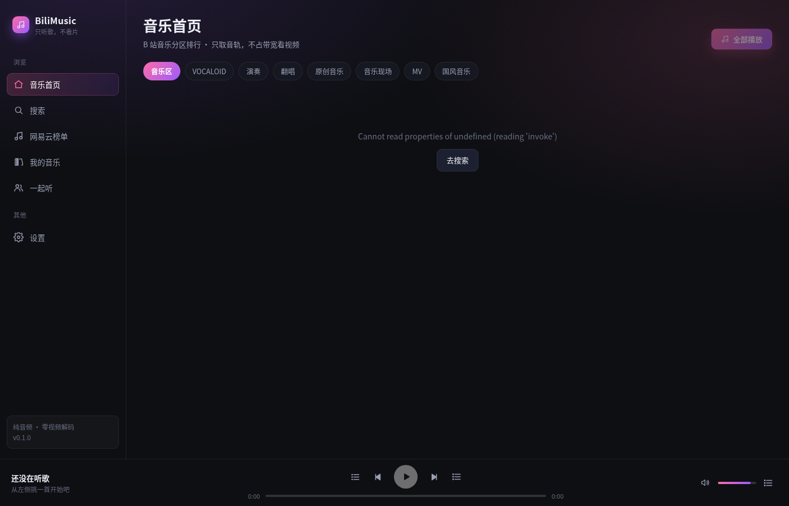

# BiliMusic

> 只用来**听**的哔哩哔哩第三方客户端 —— 把视频画面整个剥掉，只留音轨，
> 再带一个「和好友一起听」的房间功能。

支持 **GNU/Linux · Windows · Android**，桌面端与手机端共用一套 Rust 后端 + React 前端。



---

## 它是什么

B 站官方的"听视频"很好用，但你必须开着视频页面、让播放器一直解码画面。
BiliMusic 做的事情很简单也很彻底：

- **只请求 dash 里的纯音频轨**（`fnval=16` 的 `audio` 流），不下载、不解码任何视频帧。
  一首 4 分钟的歌通常只有 4~8 MB，内存占用几十 MB 级别。
- 界面是**音乐播放器**的形态：榜单、搜索、收藏、最近播放、队列、正在播放页。
  没有弹幕、没有画面、没有推荐信息流。
- **一起听**：自建一个房间服务器，好友输入 6 位房间号就能进房，
  切歌 / 暂停 / 拖动进度 / 加歌 / 聊天 全部实时同步。

## 功能一览

| 模块 | 功能 |
| --- | --- |
| B 站 | 音乐区/演奏/翻唱/原创/VOCALOID 等分区排行、关键词搜索、相关推荐、收藏夹、稍后再看、扫码登录 |
| 播放 | 纯音频流、本地代理（补 Referer / 透传 Range 支持秒拖进度）、顺序/循环/单曲/随机、音量、全局快捷键（空格、Shift+←/→） |
| 一起听 | 建房/进房、队列同步、播放状态同步（带服务器时间补偿）、成员进度小条、房主移交、踢人、房间聊天 |
| 其它 | 本地收藏与最近播放、深色 UI、窄屏/手机自适应布局 |

## 架构

```
┌──────────────────────────────────────────────────────────────┐
│  React + TypeScript 前端 (src/)                               │
│  ├── store/player.ts    播放状态机                            │
│  ├── store/together.ts  一起听状态 + 服务器时钟偏移             │
│  └── lib/audio.ts       唯一的 <audio> 元素，负责出声与对齐      │
└───────────────┬──────────────────────────────┬───────────────┘
                │ invoke / event               │
┌───────────────▼──────────────────────────────▼───────────────┐
│  Tauri 2 后端 (src-tauri/)                                    │
│  ├── bilibili.rs  wbi 签名、搜索、排行、playurl(dash audio)     │
│  ├── proxy.rs     本地音频代理 127.0.0.1:<随机端口>/stream/<tok> │
│  ├── session.rs   登录态 / 设置持久化                           │
│  └── together.rs  一起听客户端（把 sync-core 接进 Tauri）        │
└───────────────┬──────────────────────────────────────────────┘
                │
┌───────────────▼──────────────────────────────────────────────┐
│  sync-core/  一起听协议与房间状态机（桌面端 / Android 共用）      │
│  server/     可独立部署的房间服务器（axum + WebSocket）          │
└──────────────────────────────────────────────────────────────┘
```

**为什么要本地代理？**
B 站音频 CDN 会校验 Referer，且返回的是 `http` 地址；直接塞进 WebView 的
`<audio>` 会 403 或被混合内容策略拦掉。代理顺手还解决了 **Range 透传**，
所以拖动进度条是秒响应的，而不是等到整首歌缓冲完。

## 快速开始（桌面端）

前置依赖见 [Tauri 官方文档](https://tauri.app/start/prerequisites/)：
Linux 需要 `webkit2gtk-4.1`、`libsoup3`、`gtk3`；Windows 需要 WebView2（Win10/11 自带）；
另外需要 Node.js 20+ 与 Rust 1.85+。

```bash
npm install
npm run tauri:dev        # 开发模式
npm run tauri:build      # 打生产包（deb/rpm/AppImage / msi / exe）
npm run sync:server      # 顺便起一个一起听房间服务器
```

> 只想调 UI 的话，直接 `npm run dev` 在浏览器里打开即可 —— 没有 Tauri 运行时
> 会自动走内置的假数据后端，不用联网。

## 一起听：自建房间服务器

房间服务器是独立的小二进制，可以在自己电脑、NAS 或云主机上跑：

```bash
npm run sync:server:release
# 或指定端口/地址
BIND=0.0.0.0:9000 cargo run --release --manifest-path server/Cargo.toml
```

- 本机测试：App 里填 `http://127.0.0.1:8787`
- 局域网：填电脑的内网地址，例如 `http://192.168.1.10:8787`
- 公网：用 Nginx/Caddy 反代，记得同时转发 **WebSocket**（`/ws/`）

然后在「一起听」页：

1. 一个人点「创建房间」，拿到 6 位房间号；
2. 其他人填服务器地址 + 房间号「加入」；
3. 房主的操作会实时同步给所有人；任何人加的**歌曲**都会进同一个队列；
4. 拖进度条后，客户端会按服务器时间自动纠偏，偏差超过 1.2 秒才跳，避免抖动。

服务器接口：

| 方法 | 路径 | 说明 |
| --- | --- | --- |
| GET | `/health` | 健康检查 |
| POST | `/api/rooms` | 建房，body `{"name":"房间名","code":"可选"}` |
| GET | `/api/rooms/{code}` | 房间快照 |
| WS | `/ws/{code}?name=&avatar=` | 实时同步通道 |

协议细节见 `sync-core/src/protocol.rs` 与 [docs/PROTOCOL.md](docs/PROTOCOL.md)。

## Android

详细步骤（含 SDK / NDK 安装、串口调试）见 **[docs/ANDROID.md](docs/ANDROID.md)**。速览：

```bash
npm run android:init     # 首次：生成 src-tauri/gen/android
npm run android:dev      # 真机 / 模拟器热重载
npm run android:build    # 打包 APK / AAB
```

需要 `ANDROID_HOME`、`NDK_HOME`（NDK 26+）、JDK 17+，以及
`rustup target add aarch64-linux-android armv7-linux-androideabi`。

手机上本地音频代理同样跑在 `127.0.0.1`，不需要额外配置；界面在窄屏下自动切到底部标签栏。

## 目录结构

```
├── src/                 前端（React + TS）
│   ├── components/      Player / NowPlaying / QueuePanel / QrLogin / Toast / Icons
│   ├── pages/           Home / Search / Library / Together / Settings
│   ├── store/           player / together / library（zustand）
│   └── lib/             api（invoke 封装）/ audio（播放引擎）/ format / mock
├── src-tauri/           桌面端 + 安卓端 Rust 后端
│   ├── src/bilibili.rs  B 站接口（wbi 签名）
│   ├── src/proxy.rs     本地音频代理
│   ├── src/together*.rs 一起听接入
│   └── tests/           联网冒烟测试 + 代理测试
├── sync-core/           一起听协议、房间状态机、客户端连接器
└── server/              一起听房间服务器（独立部署）
```

## 测试

```bash
npx tsc --noEmit                                     # 前端类型检查
cargo test -p bili-music-sync                        # 房间状态机（离线）
cargo test -p bili-music --test proxy                # 本地代理（离线）
cargo test -p bili-music --test live -- --nocapture  # 联网冒烟（B 站）
```

## 已知限制

- **B 站没有歌词接口**（多数视频也没有字幕），所以正在播放页展示的是
  视频简介和分 P 列表，而不是歌词。
- 一起听的房间状态保存在内存里，服务器重启后房间会消失（单机场景够用）。
- 官方接口随时可能调整风控（`-352`），代码里已做密钥失效自动重试，但仍需自行承担风险。

## 免责声明

本项目仅供学习与技术研究，所有内容版权归原平台与原作者所有。
请勿用于商业用途；因使用本项目产生的任何后果由使用者自行承担。
